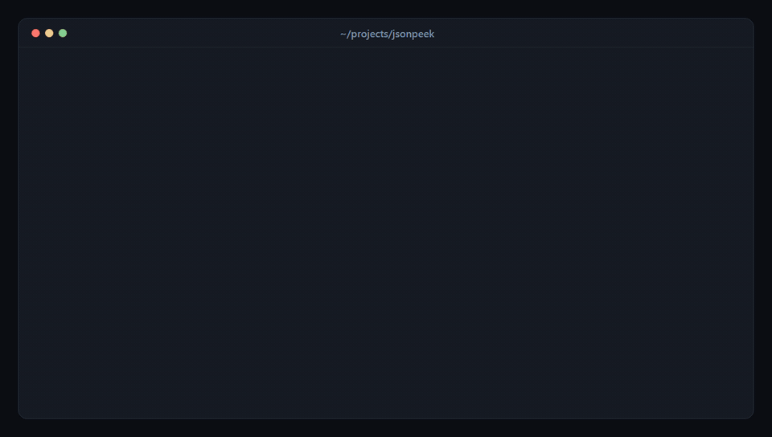

<div align="center">

# 🚀 launchscore

**Your coding agent launches your repo like a pro.**

Launch-readiness score · README rewrite · demo GIF · social preview · Hacker News, Reddit & X posts — in one command.

[](LICENSE)
[](#install)
[](#install)



<sub>A real run on <a href="examples/before/jsonpeek">examples/before</a> → <a href="examples/after/jsonpeek">examples/after</a>. Run the audit yourself to check.</sub>

</div>

## Install

```bash
npx skills add ikooq/launchscore
```

Then, in your repo, ask your agent: **"launch this repo"**.

<details>
<summary>Other ways to install</summary>

**Claude Code plugin**

```
/plugin marketplace add ikooq/launchscore
/plugin install launchscore@launchscore
```

**Manual** — copy `skills/launchscore/` into `~/.claude/skills/` (Claude Code), `~/.codex/skills/` (Codex), or your agent's skills folder.

**Just the score** — no agent needed:

```bash
npx degit ikooq/launchscore/skills/launchscore/scripts launchscore && node launchscore/audit.mjs .
```

</details>

## Why

Great projects die with 3 stars every day. Not because the code is bad — because **a stranger couldn't understand it in 10 seconds**, or **nobody saw it**. Launchscore fixes both:

- **Know where you stand** — a 0–100 Launch Score with the exact fixes ranked by impact.
- **A README that converts** — demo first, one-liner, 3-line quick start, honest comparison.
- **Assets people share** — a scripted demo GIF and a 1280×640 social preview card.
- **Posts that fit each channel** — Show HN with first comment, Reddit, X thread, Product Hunt, Lobsters, Habr, Zenn/Qiita — plus a FAQ for the skeptics.
- **A launch-day plan** hour by hour, built around how GitHub Trending actually works.

## What it does

```
you › launch this repo

launchscore › 1. Audit         Launch Score + the fixes ranked by impact
          2. Positioning   one-liner, audience, aha moment, differentiators
          3. README        rewritten to the landing-page structure (diff shown)
          4. Assets        launch/demo.gif, launch/social-preview.png
          5. Metadata      gh repo edit … (asks first)
          6. Posts         launch/posts/{hacker-news,reddit,x,habr}.md + launch/faq.md
          7. Plan          launch/plan.md — T-7 → launch hour by hour → T+7
                           re-audit: before → after score
```

Everything lands in a `launch/` folder you review. **Launchscore never posts, votes or submits anything for you.**

## The Launch Score

```
  🚀 Launch Score

  21/100  ████░░░░░░░░░░░░░░░░  Not launch-ready

  ✔ README exists                                 5pt  README.md
  ▲ Clear one-liner near the top                  8pt  42 words: "This project is a small tool that I wrote…"
  ✘ Demo GIF / image / video above the fold      15pt
  ✘ Copy-paste quick start near the top          12pt
  ✘ License file                                  8pt
  ...
  Top fixes:
  1. [+15] Add a 10–20 s demo GIF or hero screenshot right under the one-liner.
  2. [+12] Add a ```bash block with a 1–3 line install + run command near the top.
```

Calibration: well-launched repos score high — [`sharkdp/bat`](https://github.com/sharkdp/bat) (61k★) scores **97**.

17 checks across the README, repo files and GitHub metadata (description, topics, homepage, social preview, releases, good first issues, a red CI badge in the README). GitHub checks use the `gh` CLI if it's logged in and are skipped otherwise. Zero dependencies, Node ≥ 18.

Show your score in your own README: `node skills/launchscore/scripts/audit.mjs --badge` prints a ready-to-paste shields.io badge, like .

## Honest by design

Launchscore will not help you buy stars, trade stars, or ask people to upvote. Those break GitHub, Hacker News and Reddit rules, get detected, and can get your account banned. Launchscore works on what actually makes people star a repo: understanding it fast and seeing it at the right moment.

## Comparison

| | launchscore | Generic "write my README" prompt | Launch checklists / blog posts |
|---|:-:|:-:|:-:|
| Measures readiness with a score | ✅ | ➖ | ➖ |
| Reads your actual code | ✅ | ✅ | ➖ |
| Demo GIF + social preview | ✅ | ➖ | ➖ |
| Channel-native posts + FAQ | ✅ | ➖ | partial |
| Launch-day timing plan | ✅ | ➖ | ✅ |

## Roadmap

- [ ] `launchscore badge` — Launch Score badge for your README
- [ ] Post-launch report from GitHub traffic (referrers → what worked)
- [x] Lobsters, Zenn and Qiita
- [ ] More channels: Hashnode, Zhihu
- [ ] Localized posts (ES, PT, ZH, RU, JA)

## Contributing

Channel playbooks change all the time. If you know a community's norms, a PR to [`references/channels.md`](skills/launchscore/references/channels.md) is the most valuable contribution. See [CONTRIBUTING.md](CONTRIBUTING.md).

## License

[MIT](LICENSE)
