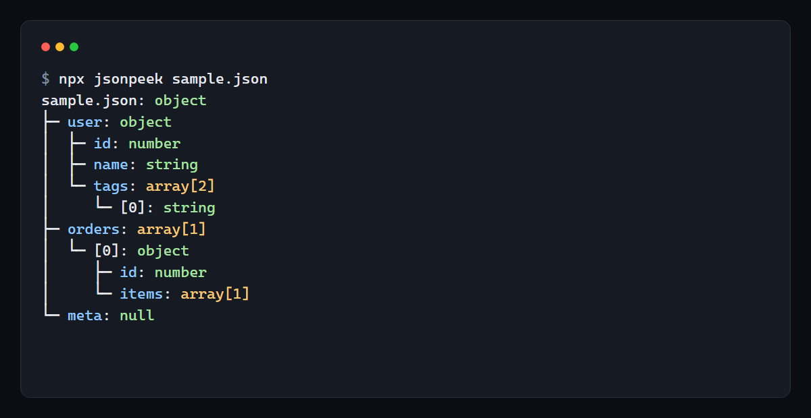

<div align="center">

# jsonpeek

**See the shape of any JSON file in one second.**



</div>

## Quick start

```bash
npx jsonpeek response.json
```

## Why

- **Understand unknown API responses instantly** — keys, types and array sizes as a tree, without scrolling 5 000 lines.
- **Zero dependencies** — one 40-line file, Node ≥ 18.
- **Safe on huge files** — shows one sample element per array and stops at depth 5.

## Examples

```bash
jsonpeek package-lock.json          # what's actually in there?
curl -s https://api.github.com/repos/nodejs/node > node.json && jsonpeek node.json
```

```
sample.json: object
├─ user: object
│  ├─ id: number
│  └─ tags: array[2]
└─ orders: array[1]
   └─ [0]: object
```

## Comparison

| | jsonpeek | `jq` | Opening in an editor |
|---|:-:|:-:|:-:|
| Structure at a glance | ✅ | needs a query | ➖ |
| No install | ✅ (`npx`) | ➖ | ✅ |
| Filtering / transforming | ➖ | ✅ | ➖ |

`jq` is the right tool for querying; jsonpeek is for the first 10 seconds with an unfamiliar file.

## Contributing

Issues and PRs welcome — see [CONTRIBUTING.md](CONTRIBUTING.md).

## License

[MIT](LICENSE)
